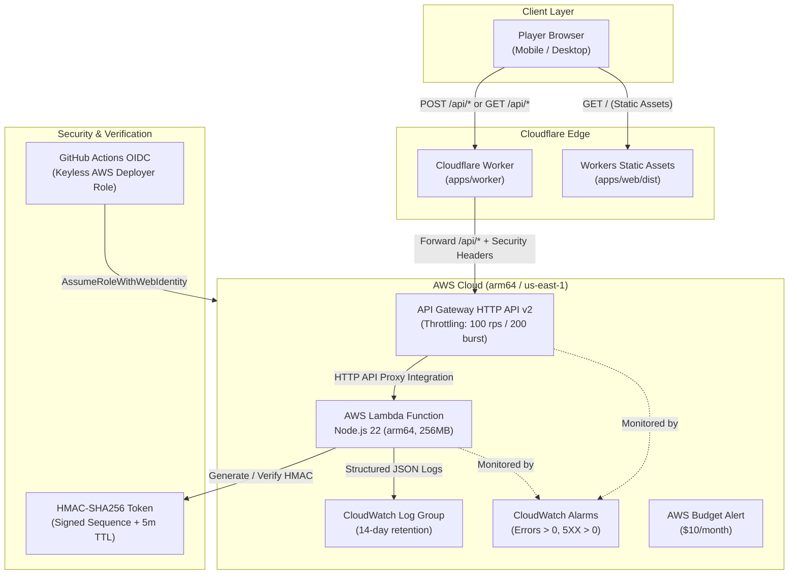

# Pulse ⚡ // High-Octane Neon Memory & Reflex Game

A tiny, production-grade, serverless web game designed with a striking dark cyberpunk aesthetic, cryptographic sequence verification, and modern cloud infrastructure.

---

## 🏛️ System Architecture

Pulse uses an edge-first architecture: the browser connects exclusively to Cloudflare's Edge Network, which serves static assets directly and reverse-proxies `/api/*` endpoints to an AWS Lambda function behind an API Gateway HTTP API (v2). This design completely eliminates CORS overhead, prevents browser latency leaks, and keeps AWS backend URLs entirely concealed.



---

## 📁 Repository Layout

```
pulse/
├── apps/
│   ├── web/                # React 18 + Vite + TypeScript game frontend
│   │   ├── src/components/ # NeonPad, ScoreBoard, ParticleCanvas
│   │   ├── src/utils/      # Web Audio API synth, API client
│   │   └── tailwind.config # Cyberpunk neon glow styling
│   ├── worker/             # Cloudflare Worker reverse-proxy & security headers
│   │   ├── wrangler.json   # Workers Assets config (run_worker_first, ASSETS binding)
│   │   └── src/index.ts    # Upstream proxying to AWS API Gateway
│   └── api/                # Node 22 arm64 Lambda handler
│       ├── src/crypto.ts   # HMAC-SHA256 sequence signer & constant-time verifier
│       ├── src/logger.ts   # Structured JSON logger for CloudWatch Insights
│       ├── src/local.ts    # Local HTTP server runner for local development
│       └── test/           # Vitest integration suite (8 tests)
├── db/
│   └── README.md           # Postgres (Neon / RDS) integration seam & schema blueprint
├── infra/
│   ├── bootstrap/          # Terraform for S3 remote state bucket (versioned, encrypted)
│   ├── modules/
│   │   ├── lambda_api/     # Lambda (arm64), API Gateway v2, IAM least-privilege, Logs
│   │   ├── github_oidc/    # OIDC identity provider & scoped GitHub deployer role
│   │   ├── observability/  # CloudWatch Alarms (Errors, 5xx) & AWS Monthly Budget
│   │   └── custom_domain/  # Optional ACM + Cloudflare DNS custom domain module
│   └── envs/
│       └── prod/           # Single production environment root
└── .github/
    ├── dependabot.yml      # Automated weekly dependency updates
    └── workflows/
        ├── ci.yml          # PR validation: typecheck, lint, test, build, terraform validate
        └── deploy.yml      # Push to main: test/build -> deploy production -> smoke test
```

---

## ⚡ API Specification

The backend API is stateless, fast, and cryptographically verified:

| Method | Endpoint             | Description                                       | Response Payload                                                       |
| ------ | -------------------- | ------------------------------------------------- | ---------------------------------------------------------------------- |
| `GET`  | `/api/health`        | Healthcheck & version status                      | `{ "status": "ok", "version": "1.0.0", "time": "..." }`                |
| `GET`  | `/api/round?level=N` | Generates sequence of length $N+2$ and HMAC token | `{ "level": 1, "sequence": [0, 2, 1], "token": "...", "padCount": 4 }` |
| `POST` | `/api/verify`        | Validates submitted answer against signed token   | `{ "correct": true, "nextLevel": 2 }`                                  |

### Cryptographic HMAC Token Design

- Tokens are formatted as `payloadBase64Url.signatureBase64Url`.
- Payload contains: `{ level, sequence, exp, nonce }`.
- Verification enforces a **5-minute expiration** (`exp`) and uses `crypto.timingSafeEqual` to thwart timing attacks.
- Secret key is generated via Terraform `random_password` and injected directly into the Lambda runtime environment (zero external API lookup delay).

---

## 🚀 Setup & Deployment Runbook

### Step 1: Bootstrap the S3 Terraform State Bucket

Ensure your AWS CLI credentials are configured (`aws configure` or SSO):

```bash
cd infra/bootstrap
terraform init
terraform apply -auto-approve
```

Save the output:

- `state_bucket_name`: e.g., `pulse-tfstate-a1b2c3d4`

---

### Step 2: Configure GitHub Secrets & Variables

In your GitHub repository, navigate to **Settings -> Secrets and variables -> Actions**:

1. **Repository Secret**:
   - `CLOUDFLARE_API_TOKEN`: Cloudflare token with `Workers Scripts: Edit` permissions.
2. **Repository Variables**:
   - `CLOUDFLARE_ACCOUNT_ID`: Your Cloudflare Account ID.
   - `TF_STATE_BUCKET`: The bootstrap bucket name (e.g. `pulse-tfstate-a1b2c3d4`).
   - `AWS_ROLE_TO_ASSUME`: `arn:aws:iam::<ACCOUNT_ID>:role/pulse-prod-github-deployer`.
   - `AWS_REGION`: `us-east-1`.

---

### Step 3: Initial Deploy via Local Terraform or Push to Main

To create the initial IAM OIDC deployer role locally:

```bash
cd infra/envs/prod
terraform init \
  -backend-config="bucket=pulse-tfstate-a1b2c3d4" \
  -backend-config="key=pulse/prod/terraform.tfstate" \
  -backend-config="region=us-east-1"

terraform apply \
  -var="github_repo=your-username/pulse" \
  -var="state_bucket_arn=arn:aws:s3:::pulse-tfstate-a1b2c3d4"
```

Once the OIDC role is established, commit and push to `main`:

```bash
git push origin main
```

GitHub Actions will automatically run:

1. `build`: typecheck, unit test, compile web and API bundles.
2. `deploy`: executes Terraform plan/apply, deploys Cloudflare Worker, and smoke-tests `/api/health`.

---

## 💻 Local Development

Run the full local stack (Lambda API dev server + Vite frontend):

```bash
# 1. Install workspace dependencies
pnpm install

# 2. Run unit tests
pnpm test

# 3. Start local development (API on :3001, Vite Web on :5173 with proxy)
pnpm dev
```

Visit `http://localhost:5173` in your browser. The Vite development server automatically forwards all `/api/*` traffic to the local API server running at `http://localhost:3001`.

---

## 💰 Cost Breakdown

| Component                 | Free Tier Allowance                                       | Estimated Monthly Cost |
| ------------------------- | --------------------------------------------------------- | ---------------------- |
| **AWS Lambda (arm64)**    | 1,000,000 requests/month free                             | **\$0.00**             |
| **API Gateway (HTTP v2)** | 1,000,000 requests/month free for 12 mos (\$1.00/M after) | **\$0.00**             |
| **CloudWatch Logs**       | 5 GB ingestion & storage free                             | **\$0.00**             |
| **Cloudflare Workers**    | 100,000 requests/day free                                 | **\$0.00**             |
| **S3 Terraform State**    | Pennies (under 10 MB state)                               | **<\$0.02**            |
| **Total**                 |                                                           | **~\$0.00 / month**    |

_Budgets are enforced automatically via AWS Budgets alerting at \$10/month._

---

## 🧹 Teardown Runbook

To completely tear down all provisioned resources without leaving orphaned infrastructure, execute in the exact order below:

```bash
# 1. Teardown Production Environment
cd infra/envs/prod
terraform destroy -auto-approve \
  -var="github_repo=your-username/pulse" \
  -var="state_bucket_arn=arn:aws:s3:::pulse-tfstate-a1b2c3d4"

# 2. Delete Cloudflare Worker
cd apps/worker
npx wrangler delete

# 3. Teardown Bootstrap S3 State Bucket (removes state locks and bucket)
cd infra/bootstrap
terraform destroy -auto-approve
```

---

## 💡 What I Learned & Next Steps

1. **Adding Postgres (Neon / Aurora Serverless v2)**:
   - A clean data-access seam is pre-architected in `apps/api/src/db/repository.ts` and `db/README.md`.
   - When player profiles or global leaderboards are required, swap `StatelessGameRepository` with a Neon HTTP driver (`@neondatabase/serverless`) to maintain zero connection pool exhaustion on Lambda.

2. **Custom Domain**:
   - The disabled-by-default module at `infra/modules/custom_domain/main.tf` documents how to attach an ACM certificate and Cloudflare CNAME record for a dedicated backend subdomain (`api.pulse.yourdomain.com`).

3. **AWS WAF & Cloudflare Security**:
   - Because Cloudflare Worker proxies `/api/*` requests, Cloudflare WAF and bot management can protect the game directly at the edge before requests reach AWS.
   - For defense-in-depth, an `aws_wafv2_web_acl` can be attached to API Gateway with an `aws:UserAgent` or secret header rule restricting API Gateway traffic exclusively to Cloudflare Worker edge IPs.
